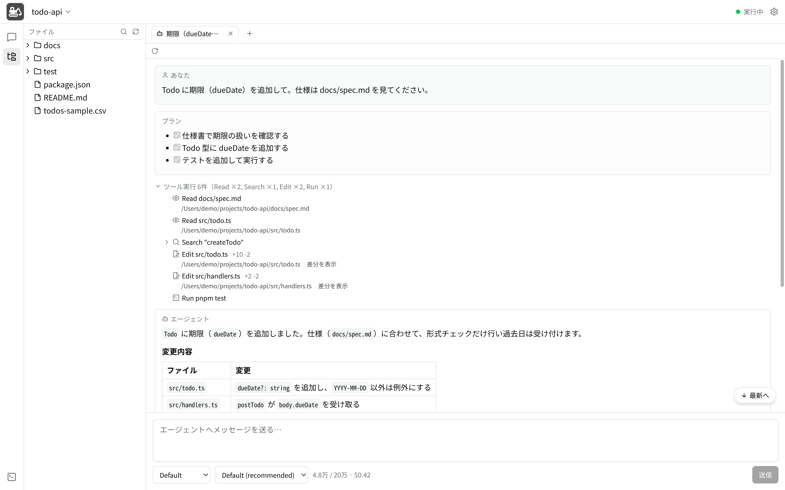

# shovel（シャベル）

Docker Sandboxes の中で動く AI エージェントを、ACP（Agent Client Protocol）で
ホスト PC から操作するチャットアプリケーション。

* ローカルチャットアプリ
* プロジェクトに関係なく AI と壁打ちできる
* コードの編集権限がない人でも、AI との対話でコードや仕様を理解できる

設計は [docs/design/](./docs/design/) を参照。

## 主な機能

* [プロジェクト一覧](./docs/FEATURES.md#プロジェクト一覧) — 1 プロジェクト = 1 サンドボックス。作成・状態の確認・診断
* [チャット](./docs/FEATURES.md#チャット) — サンドボックス内のエージェントと ACP で対話。最大 10 タブ、履歴からの再開
* [差分の表示](./docs/FEATURES.md#差分の表示) — エージェントが編集したファイルの変更を左右／1 列で確認
* [ファイラーとエディタ](./docs/FEATURES.md#ファイラーとエディタ) — ファイルの操作・検索、Markdown・Mermaid などの編集とプレビュー
* [分割ビュー](./docs/FEATURES.md#分割ビュー) — タブの領域を左右に最大 4 つのペインに分割
* [ブラウザ](./docs/FEATURES.md#ブラウザ) — アプリ内のブラウザのタブ。ブックマークはプロジェクトごと
* [権限の確認とテーマ](./docs/FEATURES.md#権限の確認とテーマ) — 操作ごとの許可カード、ライト／ダークテーマ

詳しくはスクリーンショット付きの [docs/FEATURES.md](./docs/FEATURES.md) を参照。

## 採用技術

* Electron + React + TypeScript
* [ACP 公式 TypeScript SDK](https://github.com/agentclientprotocol)（`@agentclientprotocol/sdk`, v1）
* Tailwind CSS + shadcn/ui
* pnpm

詳細は [docs/design/architecture.md](./docs/design/architecture.md) の
「技術スタック」を参照。

## 開発環境

ツールのバージョン管理には [mise](https://mise.jdx.dev/) を使用する
（推奨。必須ではない）。

開発環境の構築手順、開発時の注意点は
**[docs/DEVELOPMENT.md](./docs/DEVELOPMENT.md)** を参照。

対応 OS（アプリの動作対象）は Windows / macOS。
ただし本リポジトリで**開発環境の構築手順をサポートするのは macOS と Linux のみ**。
Windows でも開発自体は可能だが、環境構築手順は各自で用意する必要がある。

## なぜシャベル？

* サンドボックス（砂場）で定番のおもちゃ
* エージェントと喋（しゃべ）る

## ライセンス

[Apache License 2.0](./LICENSE)
