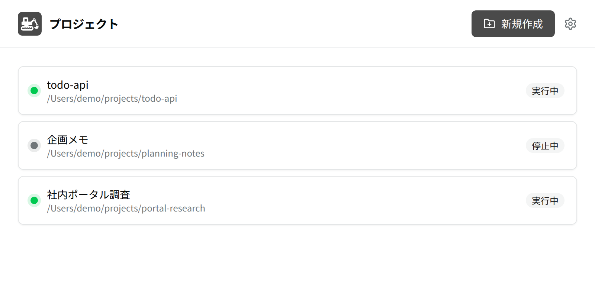
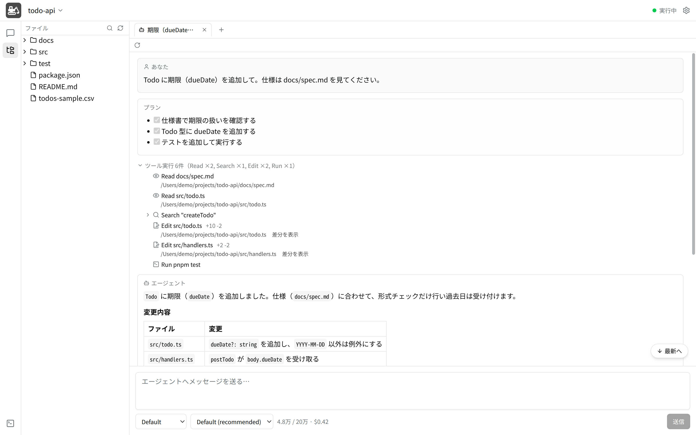
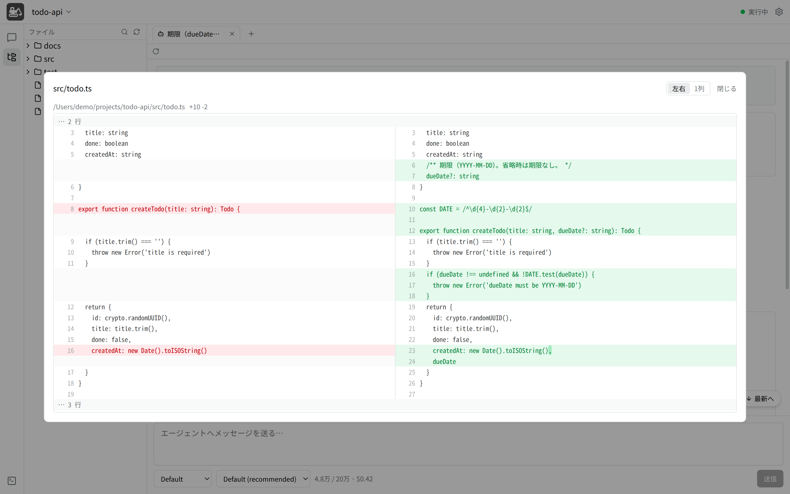
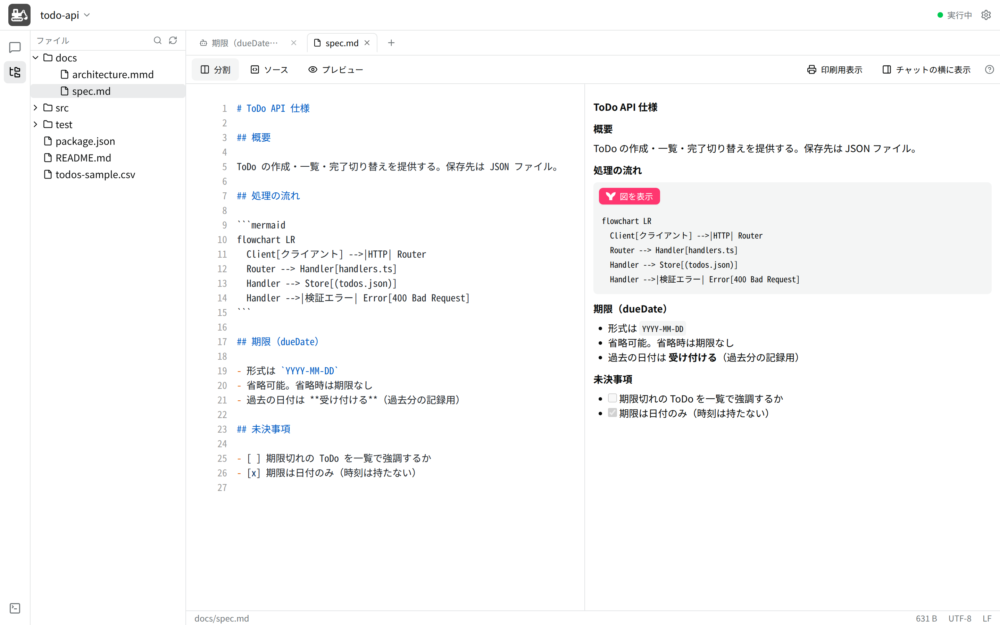
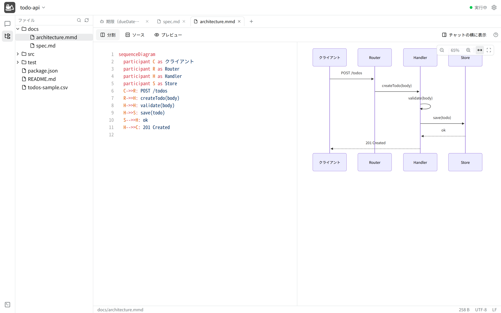
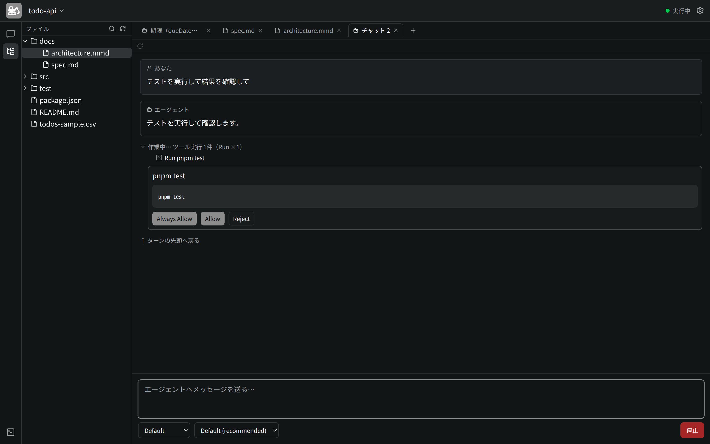

# 機能紹介

shovel の主な画面と機能を、スクリーンショットとあわせて紹介する。
設計の詳細は [design/](./design/) を参照。

> スクリーンショットはデモ用のプロジェクト（`todo-api`）で撮影したもの。
> エージェントの応答内容はデモ用で、実際のエージェントの出力ではない。

## プロジェクト一覧

起動すると最初に開く画面。1 プロジェクト = 1 サンドボックス。

* フォルダを指定してプロジェクトを作成する
* サンドボックスの状態（実行中／停止中）を表示する
* プロジェクトを開くと、プロジェクトごとのウィンドウが開く
* 「詳細」から、サンドボックスの診断や、プロキシに拒否された通信の確認・許可ができる

## チャット

サンドボックスの中で動く AI エージェントと ACP で対話する、メインの画面。

* 1 タブ = 1 セッション。タブは最大 10 個まで同時に開ける
* エージェントのプラン、ツールの実行（読み込み・検索・編集・コマンド実行）をそのまま表示する
* 返答は Markdown（表・コードのハイライト・Mermaid の図）で表示する
* 返答に含まれる選択肢（`- [ ]`）はチェックボックスになり、選んでそのまま送信できる
* Mode・Model の切り替えと、トークン使用量を入力欄の下に表示する
* `/` でスラッシュコマンドを補完する
* 会話は履歴として残り、あとから再開できる

## 差分の表示

エージェントがファイルを編集したときは、ツール実行の行の「差分を表示」から変更内容を確認できる。

* 左右表示と 1 列表示を切り替えられる
* 変更された行の中で、単語単位の違いを強調する

## ファイラーとエディタ

左側のファイラーでプロジェクトのファイルを扱う。

* フォルダ・ファイルの作成、名前の変更、削除（OS のゴミ箱へ移動）、ドラッグ & ドロップでの移動
* ファイル名と中身をまとめて検索する
* ファイルをエージェントへの「コンテキスト」として添付できる

テキストファイルは、ダブルクリックでタブとして開いて編集できる。

* Markdown・HTML はソースとプレビューの分割表示
* 自動保存。エージェントと同時に編集して衝突したときは、上書きせずに別名のコピーを残す
* Markdown は「印刷用表示」から印刷・PDF 化できる
* エディタをチャットの横に並べて、対話しながら仕様書を書ける

* Mermaid（`.mmd`）は図をプレビューする。拡大・縮小・ドラッグでの移動ができる
* JSON・YAML・CSV・画像なども、それぞれに合った表示で開ける

## 権限の確認とテーマ

エージェントがコマンドの実行などで許可を求めたときは、チャットにカードを表示する。

* 「常に許可」「許可」「拒否」から選ぶ
* 裏のタブで許可を待っているときは、タブにバッジを表示する

安全のための仕組みは次の 3 段で構成されている。

1. **サンドボックスによる隔離** — エージェントの実行・ファイル編集はサンドボックスの中で完結する
2. **権限の確認** — 上のカードで、操作ごとに許可を決める
3. **Mode** — エージェントの動き方（確認の頻度など）をユーザーが選ぶ

その他

* ライト／ダークテーマ、言語、文字サイズ、送信キーを設定で変更できる
* サンドボックス内でコマンドを実行するパネル（ターミナル表示にも対応）
